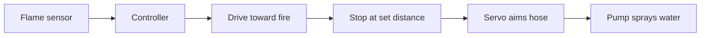

# Firefighting robot

**Phase:** before the camp. **My role:** worked on it; in one build I designed the logic behind the hose and how it holds water. **Evidence:** none preserved. Everything here is RECOLLECTION.

## Versions I remember

- With line following.
- Without line following.
- Controlled by Bluetooth.
- Controlled by an IR remote.

These may be versions of one body of work, not four projects. What differed between them is not recalled (UNKNOWN). One build involved me, an instructor and three other people.

## Ownership

| | |
|---|---|
| Organization-owned | UNKNOWN. I treat these as program work. |
| Student-built | Nothing. |
| My contribution | In the four-person build, the logic behind the hose and how it holds water. The exact scope is not recalled. |
| Public reconstruction | The diagram is generic. |

## How it worked

An IR flame sensor detected fire. The robot drove toward the fire and stopped at a set distance. A servo turned the hose toward the heat, and a pump sprayed water from a small bottle.

## Concept diagram (generic)

## Not recalled

The controller model, motor driver, power supply, how the stopping distance was set, the differences between versions, and any failures.
