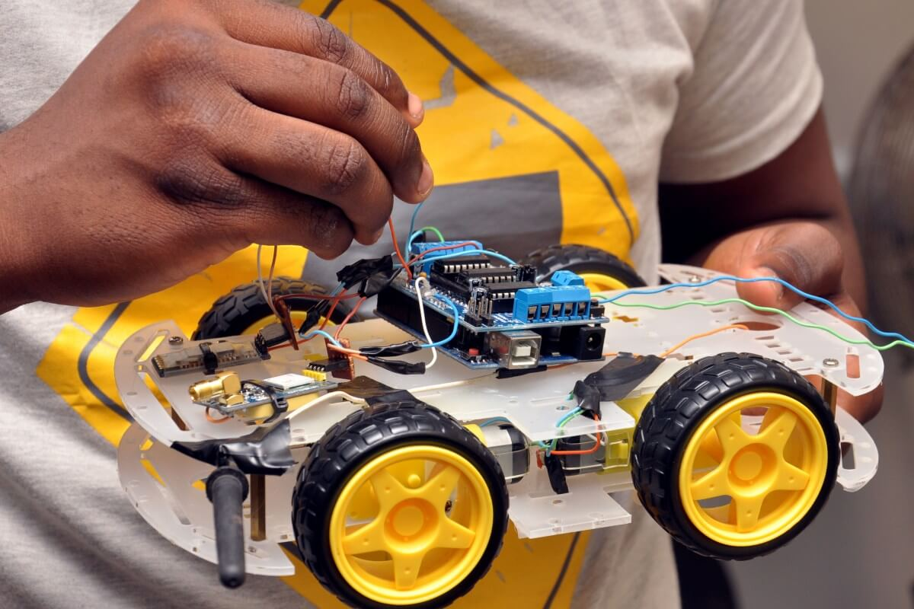
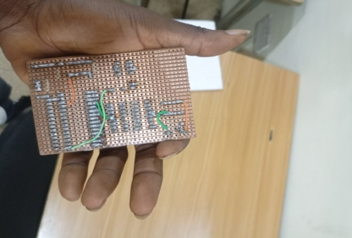
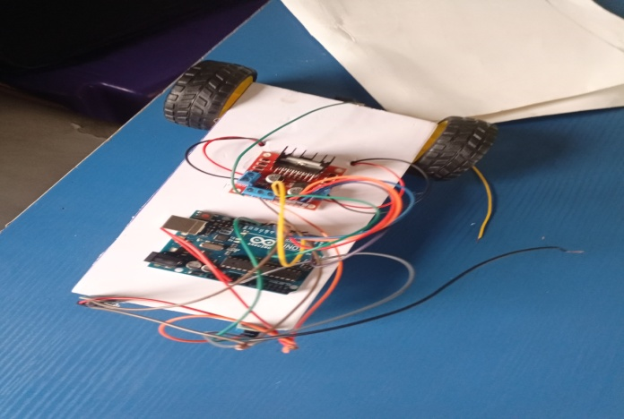
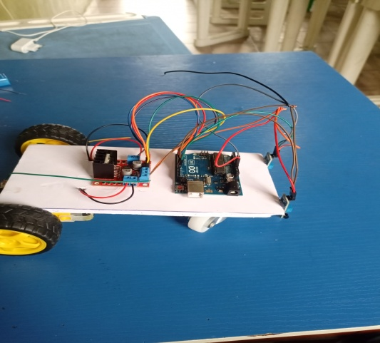
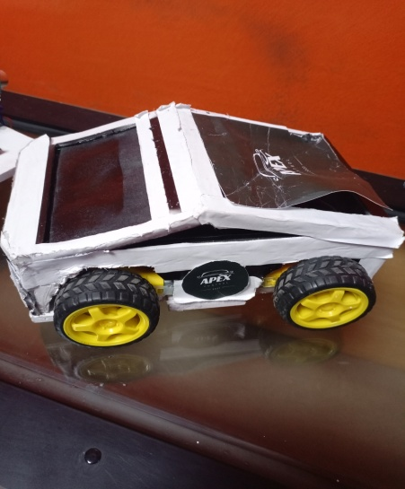
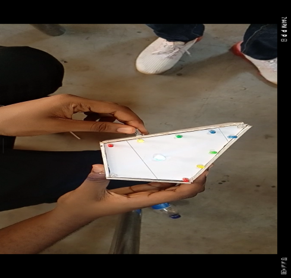
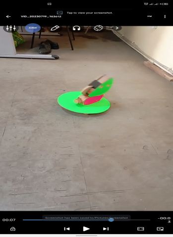

# Other projects and exercises

All RECOLLECTION. Roles use my own wording. Phase = before / during / after the camp.

## Smaller builds

| Project | Phase | What I remember |
|---|---|---|
| Custom lamp | Before | Designed it myself from foam board. The first design cast unwanted shadows. An instructor showed me that reflective silver lining spreads the light, and adding it improved the light a lot. |
| Air-freshener fan | Before | Designed it myself in cardboard. An instructor reviewed it and I changed it. Arduino control was added so the fan runs about 2 to 3 minutes roughly every 30 minutes. |
| Moving toy baby | Before | Built with another instructor, who later became my assistant. Arduino and two servos. The first version moved awkwardly. We added balancing weight and rebuilt it so the balance sat at the midpoint, and the movement smoothed out. |
| Water-level monitor | Before | A four-level version with conductive probes and LEDs, later an ultrasonic and LCD version showing a percentage. |
| Bluetooth car | After | Four-wheel-drive car on Arduino with a MIT App Inventor app (forward, backward, left, right). A demonstration and advertising piece. |
| Automatic dustbin | After | I built it with Arduino, an ultrasonic sensor and a servo. The lid opens when someone is near and closes after about 3 seconds. |
| Keypad lock | After | Keypad and servo. One version in a small house model, and a password safety box. How the two relate is not recalled. |
| Obstacle-avoiding robot | After | Arduino, an ultrasonic sensor on a servo, and motors. It stops, looks in different directions and picks a free one. It is not a line follower. |

## Demonstration pieces with few details

| Project | What I remember |
|---|---|
| Tesla project | Built as a demonstration and advertisement for the program. Arduino, four servos and a servo driver board. Its purpose and the board model are not recalled. |
| Blind-man belt | A demonstration piece. A wearable obstacle detector with an ultrasonic sensor and Arduino. The warning output is not recalled. |
| Smart-home thermostat | I remember the project but not its sensors, outputs or logic. |

## Teaching exercises

Potentiometer-dimmed light, an LM35 temperature sensor read on the serial monitor, an LCD progression (including Bluetooth and App Inventor text), an IR remote controlling LEDs and a fan, and an ultrasonic proximity LED. These followed the Arduino exercise order in my training report. Phases are not recalled.

## Hardware photographs (project not identified)

All photographs below show hardware only. I cannot say which project each belongs to.

*A hand holding a four-wheel robot chassis with an Arduino-style board and wiring.*

*A hand holding a soldered perfboard circuit.*

*A wheeled chassis prototype with an Arduino-style board and wiring.*

*A chassis with an Arduino-style board and a motor-driver module.*

*A white-bodied wheeled robot car.*

*A still from a video: hands holding a white tray prototype with coloured markers on it.*

*A still from a video: a small robot on a floor.*
