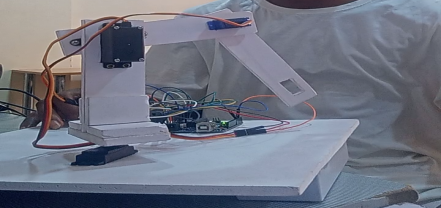

# Robotic arm repair

**Phase:** before the camp. **My role:** repair. **Evidence:** one screenshot from a video (private). Everything on this page is RECOLLECTION unless labelled otherwise.

## Ownership

| | |
|---|---|
| Organization-owned | The arm. An instructor built it as a demonstration piece. |
| Student-built | Nothing. |
| My contribution | The repair below. I worked alone, and an instructor approved the result. |
| Public reconstruction | The diagram is generic. It is not the arm's design. |

## What happened

The arm worked before it was transported to a demonstration. A driver handled it roughly on the way, and it came back damaged. I repaired it and it worked again.

## The arm as I remember it

- Three servo motors, plus two mini servos used for picking and dropping.
- Controlled by an Arduino.
- A potentiometer, and a plastic part in the structure.
- Not recalled: the board model, the power supply, what the potentiometer did, and the pin assignments.

## Faults and repairs

| Fault | What I did |
|---|---|
| Broken potentiometer | Resoldered it. |
| Faulty wire | Replaced it and reconnected it to the Arduino. |
| Plastic part too weak | Replaced it with firmer foam board. |

## Debugging record

| Step | What I know |
|---|---|
| Observation | A broken potentiometer, a faulty wire and a weak plastic part. Which movements failed is not recalled (UNKNOWN). |
| Hypothesis | UNKNOWN |
| Test | How I located the faults is not recalled (UNKNOWN). |
| Cause | Rough handling in transport. |
| Fix | The three repairs above. |
| Retest | It worked again. How I tested it is not recalled (UNKNOWN). |

## What I take from it (reflection in hindsight)

A multimeter shows what reads and what does not, and where a connection fails, so a fault can be pinpointed quickly. This is a lesson I draw now. It is not a record of the tools I used on this arm.

## Concept diagram (generic, not the arm's design)

## Limits

The original video is lost. Only one screenshot survives. I cannot say how I found the faults or how I tested the repair.

## Photographs

*Still from a video, cropped to remove a person: a white robotic arm with servo motors on a base board. In my recollection this is the arm in this case study. The still does not show the repair.*

## What came after

This repair shaped the direction of my final-year Mechatronics project, [RepeatoArm](https://github.com/velrite/RepeatoArm) (2023-2024). RepeatoArm keeps the potentiometer-and-button control of that arm and adds record-and-replay of poses and a separate proximity alarm. It is documented in its own repository.
