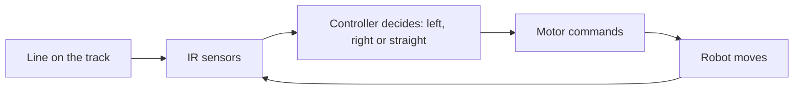

# Student line-following robot

**Phase:** before and during the camp. **My role:** taught and supervised. **Evidence:** one photograph of the track (private pending permission). Everything here is RECOLLECTION unless labelled otherwise.

## Ownership

| | |
|---|---|
| Organization-owned | The course, the kits, and the main program the company supplied. |
| Student-built | The robots, the circuits, and the code (the students wrote it). |
| My contribution | Taught the lessons, monitored the group, made the line and track with the students, checked circuits, did the hot-glue steps, and helped when students were stuck. |
| Public reconstruction | The diagram is generic. |

## What it was

A group project for the students in my class. Their robot followed a line track. One of my students presented it at the Tech Expo, where parents judged. I also worked with line following before the camp, during my training. I do not recall the details of that earlier work.

## What I remember of the build

- Sensors: IR LED-based (the exact module is unverified; the count is UNKNOWN).
- Controller: Arduino (Uno, per my recollection).
- Not recalled: the motor driver, motors, chassis, power supply and test method.

## How the students got there

The lessons followed the order in my training report: technology and its progression, electricity, tools and components, multimeter, circuits, sensors, programming, Arduino exercises, then projects. See [teaching](../03-engineering-and-mentorship/teaching-approach.md).

## Debugging

When a student circuit failed, I read the circuit and checked it against what was built, then tested wire connectivity with a multimeter. I do not recall specific line-follower failures (UNKNOWN).

## Concept diagram (generic, not the company program)

## Limits

I do not know how each student robot performed. Only one student presented at the Expo.
