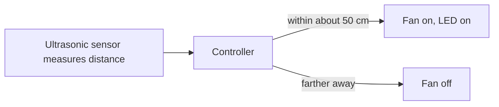

# Take-home proximity fan ("automated AC")

**Phase:** during the camp. **My role:** taught and supervised. **Evidence:** none preserved. Everything here is RECOLLECTION.

## Ownership

| | |
|---|---|
| Organization-owned | The kit and the main program the company supplied. |
| Student-built | The circuit and the code. Each student kept their own kit. |
| My contribution | Taught the lessons, checked circuits, and did the hot-gluing because students did not use the glue gun. |
| Public reconstruction | The diagram is generic. |

## What it did

The fan switched on when someone came within roughly 50 cm and switched off when they moved away. Students called it the "automated AC".

## Parts as I remember them

Arduino (Uno, per my recollection), an ultrasonic sensor, a fan, an LED, a 9V battery with a switch, and a foam board body joined with hot glue.

## Not the same as my own fan

I separately designed a timed air-freshener fan. See [other projects](other-projects.md). The two are different projects.

## Concept diagram (generic)

## Not recalled

The exact distance in the code, how each student's version differed, and any failures.
