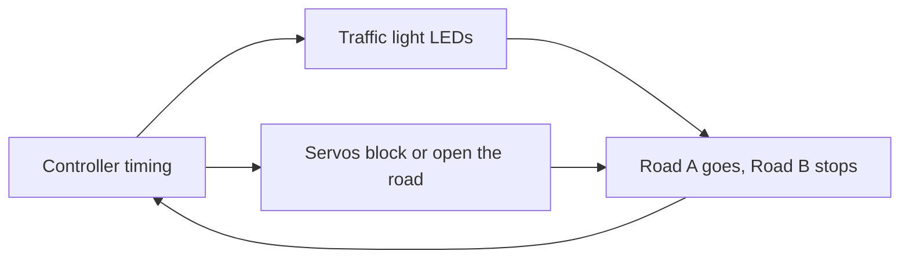
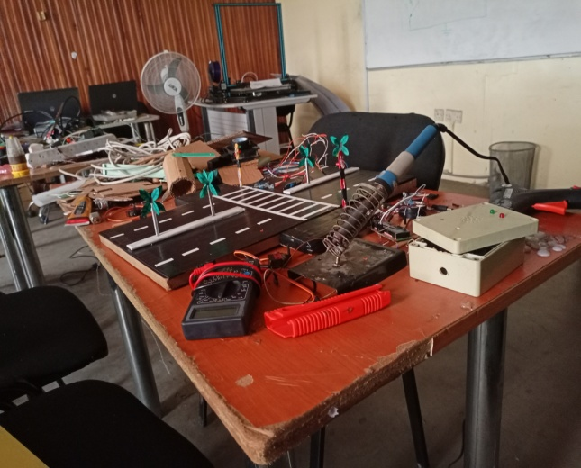
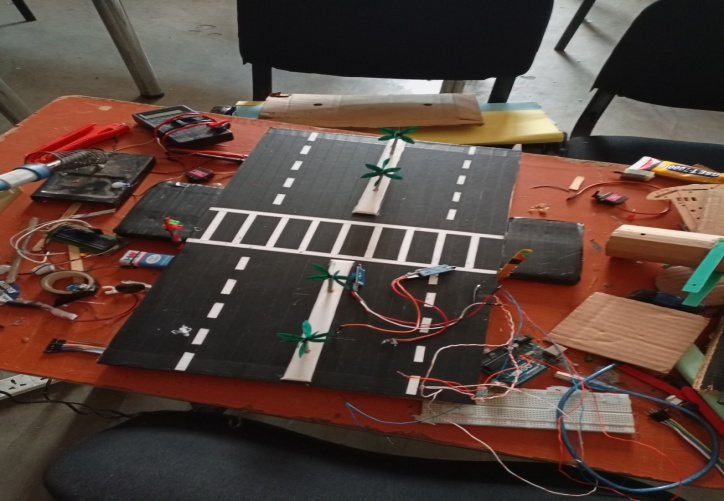
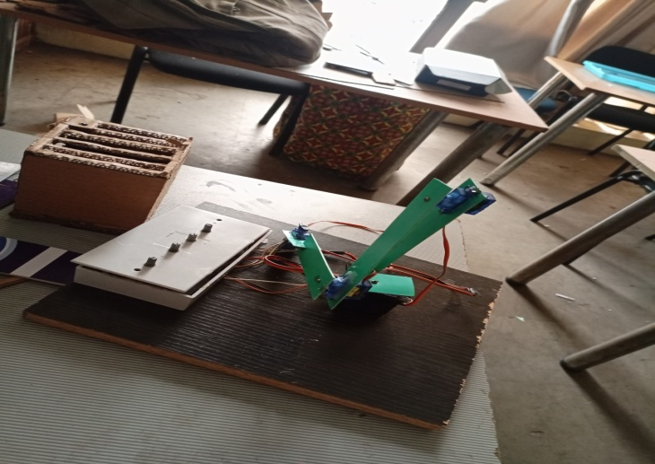

# Traffic signal model

**Phase:** after the camp. **My role:** designed the model; it was a team build. **Evidence:** three photographs (private, withheld pending written permission). Everything here is RECOLLECTION except what the photographs show.

## Ownership

| | |
|---|---|
| Organization-owned | Not yet confirmed with Center4Tech whether it was a company demonstration piece. |
| Student-built | Nothing. |
| My contribution | The design of the model: the road, the paper-flower decoration idea, and the servo road-blocking mechanism. Team members built it with me. |
| Public reconstruction | The diagram is generic. |

## What it was

A miniature road with traffic lights and a crossing. An Arduino controlled the LEDs. Two small servos blocked the road. The system ran in sequence: one road went while the other was stopped, then they swapped. The model used wood, with paper flowers and other paper decoration.

## Evidence

The photographs are DIRECT EVIDENCE that the model existed. They do not show who designed it.

## Concept diagram (generic)

## Not recalled

The team size, the timing values, what failed, and the board model.

## Photographs

*The traffic model on a workbench during the build, with tools nearby that appear to include a multimeter and a soldering iron. It shows the model existed. It does not show who designed it.*

*Miniature road with a zebra crossing and wiring, from the traffic signal model.*

*A raised barrier arm on a wooden base, from the traffic signal model.*
