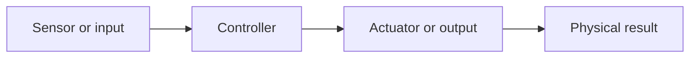

# Engineering concepts across the projects

The pattern in most of these projects: something senses the world, a controller decides, and something acts.

| Project | Input | Controller | Output |
|---|---|---|---|
| Automatic dustbin | Ultrasonic sensor | Arduino | Servo opens the lid for about 3 seconds |
| Take-home fan | Ultrasonic sensor | Arduino | Fan and LED on within about 50 cm |
| Firefighting robot | IR flame sensor | Controller | Drive, stop at a distance, servo aims the hose, pump sprays |
| Laser alarm | LDR | Arduino | Buzzer when the beam is broken |
| Line follower | IR sensors | Controller | Motor commands |
| Obstacle-avoiding robot | Ultrasonic sensor on a servo | Arduino | Motors |
| Keypad lock | Keypad | Arduino | Servo moves the lock |
| Water-level monitor | Probes, later an ultrasonic sensor | Arduino in the later version | LEDs, later an LCD percentage |

In the line follower the robot's movement changes what the sensors read, which is a feedback loop.

## Mechanical and optical faults

The faults I remember best were physical as often as electrical: a weak plastic part, an unbalanced body, a lamp that cast shadows, and a beam that had to be aligned.

## What I do not claim

I do not claim control theory, tuning methods or measured performance. These were educational and demonstration builds.
